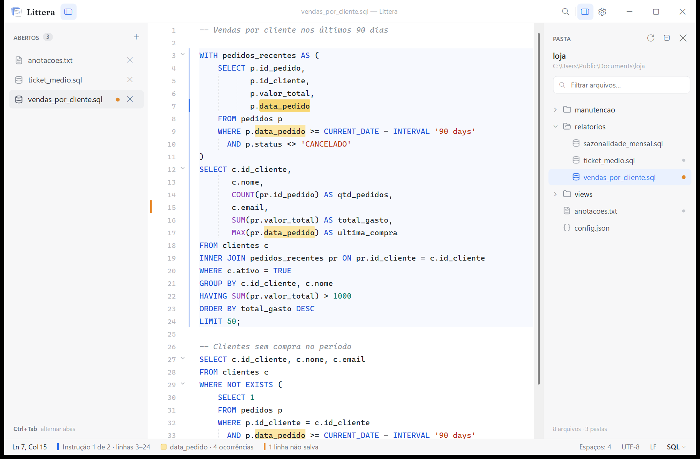

<p align="center">
  
</p>

<h1 align="center">Littera</h1>

<p align="center">
  Editor de texto leve para Windows, feito para SQL e texto.<br>
  C# · .NET 10 · WinForms · Scintilla
</p>



O nome vem do latim *littera*, "letra". A ideia é a leveza do Notepad++ com um visual limpo: abre rápido, gasta pouca
memória, aguenta arquivos grandes e entende SQL de verdade (blocos, formatação, trechos recolhíveis com resumo).

## Recursos

**Abas e pastas**

- Abas verticais em duas seções, "Fixadas" e "Abertos". A aba fixada não fecha por Ctrl+W nem pelo botão do meio e
  sempre volta ao reabrir. Arraste para reordenar ou mudar de seção.
- Clique direito na aba: fechar outras ou as já salvas, copiar caminho, mostrar na pasta, renomear (F2), duplicar e
  descartar alterações. Arquivo apagado ou movido fora do Littera aparece riscado.
- Painel "Pasta" com árvore, filtro, atualização automática e marca dos arquivos já abertos; Ctrl+P abre um arquivo
  da pasta pelo nome.
- Os dois painéis laterais mudam de largura arrastando a borda (clique duplo volta ao padrão).
- Ícones por tipo de arquivo (SQL, código, JSON, XML/YAML, tabela, configuração, documentação, log, texto).

**Edição**

- Realce de SQL (T-SQL/ANSI), JSON, XML, C#, JavaScript, Python, Markdown e texto; a linguagem também pode ser
  escolhida na barra de status.
- Bloco atual destacado (a instrução SQL ou o parágrafo), ocorrências da palavra do cursor e o parêntese que fecha
  o do cursor (em vermelho quando não tem par).
- Trechos recolhíveis pela seta da calha: instruções, parênteses, BEGIN/CASE…END e comentários em SQL; parágrafos em
  texto; chaves, tags e recuo nas outras linguagens. O trecho recolhido mostra um resumo
  ("8 linhas │ SELECT 4 colunas · FROM pedidos · WHERE 2 filtros"); parar o mouse nele abre a prévia.
- Linhas alteradas marcadas na calha: laranja = não salva, verde = salva. Clicar na barra mostra o que mudou, com
  "Copiar original" e "Reverter".
- Formatador de SQL configurável, comentar/descomentar (`--` em SQL), duplicar e mover linhas, múltiplos cursores,
  seleção em coluna (Alt+arrastar), Enter mantendo a indentação, guias de indentação, zoom e quebra de linha.
- Buscar e substituir com regex, maiúsculas e palavra inteira, no arquivo, no bloco, na seleção, nas abas abertas ou
  na pasta inteira.
- Paleta de comandos (Ctrl+Shift+P) com todos os comandos, linguagem, encoding, quebra de linha e arquivos recentes.

**Arquivos**

- Encoding (UTF-8, UTF-8 com BOM, ANSI, UTF-16) e fim de linha detectados e convertidos pela barra de status.
- Arquivos de 50 MB abrem em blocos, sem travar a janela.
- A sessão volta ao reabrir, com as abas, a posição do cursor e os trechos recolhidos. Alterações não salvas ficam em
  rascunhos e também voltam.
- Arquivo novo é salvo como `.txt` por padrão.

## Atalhos

| Atalho | Comando | Atalho | Comando |
|---|---|---|---|
| Ctrl+N / Ctrl+O | Novo / abrir | Ctrl+F / Ctrl+H | Buscar / substituir |
| Ctrl+Shift+O | Abrir pasta | F3 / Shift+F3 | Próxima / anterior |
| Ctrl+S / Ctrl+Shift+S | Salvar / salvar como | Ctrl+G | Ir para linha |
| Ctrl+W | Fechar aba | Ctrl+Shift+F | Formatar SQL |
| Ctrl+Tab | Próxima aba | F11 | Modo foco |
| Ctrl+B / Ctrl+Shift+E | Painel de abas / de pasta | Alt+Z | Quebra de linha |
| Ctrl+Plus / Minus / 0 | Zoom | Ctrl+Shift+L | Números de linha |
| Ctrl+P | Ir para arquivo da pasta | Ctrl+, | Configurações |
| Ctrl+Shift+[ | Recolher trecho do cursor | Ctrl+Shift+] | Expandir trecho do cursor |
| Ctrl+Shift+P | Paleta de comandos | Ctrl+/ | Comentar ou descomentar |
| Ctrl+D | Duplicar linha ou seleção | Alt+↑ / Alt+↓ | Mover linha |
| Alt+F5 | Próxima alteração | Shift+Alt+F5 | Alteração anterior |
| Ctrl+Alt+P | Fixar ou desafixar a aba | Ctrl+Alt+C | Copiar caminho do arquivo |
| F2 | Renomear o arquivo da aba | Alt | Menu do app |

Os atalhos podem ser trocados no `settings.json` (seção `shortcuts`, vários separados por `;`). Teclas como `[` e `]`
seguem o layout do teclado (ABNT2 ou americano).

## Instalação

O Littera é um único arquivo, `Littera.exe`, sem instalador. Requer Windows 10 ou 11 de 64 bits.

```powershell
.\publish.ps1 -Mode sc   # artifacts\publish\sc\Littera.exe: leva o .NET junto, roda em qualquer Windows x64
.\publish.ps1 -Mode fd   # artifacts\publish\fd\Littera.exe: ~4 MB, precisa do .NET 10 Desktop Runtime
```

Copie o exe para uma pasta fixa (por exemplo `C:\Programas\Littera`) e crie um atalho ou fixe na barra de tarefas.
Como o exe não tem assinatura digital, na primeira vez o Windows pode avisar "O Windows protegeu o computador":
"Mais informações" → "Executar assim mesmo".

## Configurações e dados

| O quê | Onde |
|---|---|
| Configurações (também pela janela Ctrl+,) | `%APPDATA%\Littera\settings.json` |
| Sessão e rascunhos não salvos | `%APPDATA%\Littera\` |
| Log de erros inesperados | `%LOCALAPPDATA%\Littera\erros.log` |
| Scintilla.dll e Lexilla.dll extraídas do exe | `%LOCALAPPDATA%\Littera\native\` |

Para levar suas preferências para outro PC, copie o `settings.json`. O app se chamava Notas: na primeira abertura
como Littera, as pastas `%APPDATA%\Notas` e `%LOCALAPPDATA%\Notas` são renomeadas para `Littera`.

## Desenvolvimento

Requer Windows e o [SDK do .NET 10](https://dotnet.microsoft.com/download/dotnet/10.0). O Visual Studio é opcional.

```powershell
dotnet build Littera.slnx
dotnet test
dotnet run --project src\Littera -- samples\exemplo.sql
```

```text
src/Littera/
  Editor/      documentos, carga em blocos, linguagens, trechos recolhíveis, marcas de alteração,
               realces, busca e formatador de SQL
  Services/    leitura e gravação de arquivos, encoding, rascunhos, pastas de dados, métricas
  Settings/    settings.json e session.json (System.Text.Json com geração de código)
  Theme/       cores, fontes, ícones (Lucide desenhado em vetor), logo e nome
  UI/          janela e barra de título próprias, painéis, menus, paleta, busca e configurações
  Assets/      ícone do app e a fonte do nome
tests/Littera.Tests/   testes xUnit
tools/         medição de abertura e memória, gerador de arquivo grande, captura de tela
docs/          medições de cada fase e imagens do README
```

Algumas decisões:

- **Sem frameworks de UI.** WinForms puro, sem designer, MVVM ou injeção de dependência. Painéis, menus, abas e barra
  de título são desenhados à mão no estilo do protótipo; a barra de título própria mantém Snap Layouts e Aero Snap.
- **Um editor Scintilla por documento.** Trocar de aba não recarrega texto, e arquivos grandes são carregados em
  blocos para a janela não travar.
- **Trabalho pesado fora da thread da interface.** Trechos recolhíveis, marcas de alteração e busca em pasta são
  calculados em segundo plano e aplicados só se o texto não mudou no meio do caminho.
- **Exe único e rápido.** Publicação single-file com ReadyToRun; as DLLs nativas do Scintilla vão embutidas e são
  extraídas uma vez, conferidas byte a byte a cada abertura.

## Desempenho

Metas: abrir em menos de ~300 ms, menos de ~50 MB de memória ociosa e abrir um arquivo de 50 MB sem travar a janela.

```powershell
.\tools\measure.ps1 -Exe .\artifacts\publish\fd\Littera.exe -File .\samples\exemplo.sql
.\tools\make-bigfile.ps1    # gera artifacts\bench\grande-50mb.sql
.\tools\measure.ps1 -Exe .\artifacts\publish\fd\Littera.exe -File .\artifacts\bench\grande-50mb.sql -Runs 3
```

O `measure.ps1` mede a abertura (do processo até a janela pintada e ociosa), o tempo do arquivo, o maior
travamento da interface e a memória como o Gerenciador de Tarefas mostra. A variável `LITTERA_HOME` troca a pasta de
dados, para medir sem tocar na sessão real. Números de cada fase em [docs/medicoes.md](docs/medicoes.md).

## Créditos

- [Scintilla e Lexilla](https://www.scintilla.org): o componente de edição e os realces de sintaxe.
- [Scintilla5.NET](https://github.com/desjarlais/Scintilla.NET): o controle WinForms sobre o Scintilla.
- [Lucide](https://lucide.dev): os ícones de arquivo e pasta.
- [Fraunces](https://github.com/undercasetype/Fraunces): a fonte do nome na barra de título.

Os avisos de licença desses componentes estão em [THIRD-PARTY-NOTICES.txt](THIRD-PARTY-NOTICES.txt).
